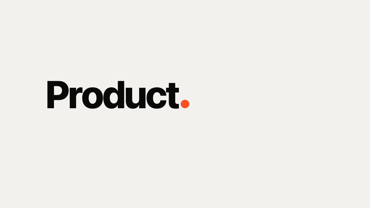

# Product Demo Video

An agent skill that turns a product URL into a launch or demo video, rendered from code.
Your AI agent captures the real product, plans shots on a beat grid, animates them in the
style of the most-shared Claude Opus 5.5 videos, critiques its own frames until every score is
8+, and renders 16:9, 9:16 and 1:1 MP4s with music, sound effects and an optional voiceover
with captions.



*The built-in 11-second template with placeholder UI. Your run replaces it with your real
screens, copy, colors and fonts.*

Works with any agent that can run shell commands: **Claude Code, Codex, Cursor, Gemini CLI,
GitHub Copilot, OpenCode** and others that read the open Agent Skills format (`SKILL.md`). It's tuned for Claude Opus 5.5 and says so
(once) if you're on another model.

## Install

Pick your tool. Every option installs the same skill.

| Tool | Install |
|---|---|
| **Claude Code** | `/plugin install product-demo-video --marketplace PavanPatel007/product-demo-video-skill` |
| **Codex** (CLI or app) | `codex plugin marketplace add PavanPatel007/product-demo-video-skill` then `codex plugin add product-demo-video@product-demo-video` |
| **Gemini CLI** | `gemini extensions install https://github.com/PavanPatel007/product-demo-video-skill` |
| **Cursor, Copilot, OpenCode and other agents** | `npx skills add PavanPatel007/product-demo-video-skill` |
| **Every agent on this machine at once** | `curl -fsSL https://raw.githubusercontent.com/PavanPatel007/product-demo-video-skill/main/install.sh \| bash` |
| **Claude.ai / Claude desktop** | Download `product-demo-video.zip` from [Releases](https://github.com/PavanPatel007/product-demo-video-skill/releases/latest), then Settings → Capabilities → Skills → Upload |

<details>
<summary>Older Claude Code, manual install, updating</summary>

**Claude Code before 2.1.275:**

```text
/plugin marketplace add PavanPatel007/product-demo-video-skill
/plugin install product-demo-video@product-demo-video
```

**Manual:** copy `skills/product-demo-video` into your agent's skills folder:

| Agent | Skills folder |
|---|---|
| Claude Code | `~/.claude/skills/` (or `.claude/skills/` in a project) |
| Cursor | `~/.cursor/skills/` |
| Codex | `~/.agents/skills/` (older versions: `~/.codex/skills/`) |
| Gemini CLI | `~/.gemini/skills/` |
| GitHub Copilot | `~/.copilot/skills/` |
| OpenCode | `~/.config/opencode/skills/` |
| Anything else | Point the agent at `skills/product-demo-video/SKILL.md`; [`AGENTS.md`](AGENTS.md) explains it |

**Update:** re-run the install command, or use your tool's updater: `npx skills update`,
`codex plugin marketplace upgrade`, `gemini extensions update product-demo-video`, or
`/plugin` in Claude Code.
</details>

### Web chat apps (Claude.ai, ChatGPT)

The skill renders video with headless Chrome and ffmpeg on your machine. Web chat sandboxes
can follow the method (brief, shot list, the animation code) but usually can't capture your
site or render the MP4. For the full pipeline, use a local agent: Claude Code or the Claude
desktop app's Code tab, or Codex for ChatGPT users.

### Requirements

Node 18+, ffmpeg, git, and Google Chrome or Microsoft Edge. The skill installs Playwright (about
10 MB) once and renders with Playwright's headless shell when it's already on your machine (no
windows, no Dock icons), otherwise the browser you already have; it downloads Chromium only if
neither is installed. Optional: Xcode's iOS Simulator or `adb` for native mobile apps, and Python with
librosa if you bring your own music track. On Windows, use WSL or Git Bash (the mixing scripts
are bash).

```bash
brew install node ffmpeg              # macOS
sudo apt install nodejs npm ffmpeg    # Debian / Ubuntu
```

## Use

Ask your agent:

> Make a 30-second launch video for https://yourproduct.com

or name the skill: *"Use the product-demo-video skill for https://yourproduct.com"*. To match
a video you like, add it: *"...in the style of https://x.com/someone/status/123"*.

How a run goes:

1. **Model check.** If you're not on Claude Opus 5.5, a one-time reminder and how to switch.
2. **A few questions.** Style, length, formats, music, look, mascot, an optional AI
   voiceover (ElevenLabs, OpenAI, Google Cloud, Azure, or a free local voice), and whether it
   may read your product's code.
3. **Real assets, best source first.**
   - **Your code** (only if you say yes, read-only): exact colors, fonts, logo, icons, wording
     and the list of screens.
   - **Your live app as vector UI**: every page is saved as boxes, text and icons instead of a
     flat screenshot, so it stays sharp when the camera zooms in and each card can move on its
     own. A comparison image and match score show how faithful each copy is.
   - **Logged-in apps**: a browser window opens and you sign in yourself (SSO, 2FA, passkeys);
     no password is saved, and it only looks.
   - **iOS and Android apps**: screenshots and recordings from the iOS Simulator or an Android
     device, with a clean 9:41 status bar.
4. **Shot list on a beat grid.** You approve it once; after that it works without stopping.
5. **Build and self-critique.** It renders one still per beat, looks at them, scores 1-10,
   fixes the 3 worst problems and repeats until every score is 8+.
6. **Render and audit.** 60 fps H.264, music and sound effects mixed to -14 LUFS, then a
   motion audit checks for frozen moments, single-frame pops and sounds out of sync.
7. **Cost report.** For example: *"This 56-second video used 3.1M tokens and cost about
   $9.40, plus $0.18 for the voiceover."*

### Where files go

Only the finished videos land in the folder you run your agent from, for example
`acme-16x9.mp4` and `acme-9x16.mp4`. No project folder, no `node_modules`, no drafts.

The work happens in `~/.cache/product-demo-video/projects/<product>/` (set `PDV_HOME` to move
it). Drafts are deleted after delivery; the film's source (a few MB) stays, so *"change the CTA"*
or *"make a 9:16 version"* later is a quick re-render. Playwright is installed there once and
shared by every video.

```bash
node ~/.claude/skills/product-demo-video/studio/workspace.mjs list            # every workspace and its size
node ~/.claude/skills/product-demo-video/studio/workspace.mjs clean acme --all # remove one completely
```

(Use your agent's skills folder in place of `~/.claude/skills` if it's different.)

## The look

The default look comes from studying the most-shared Opus 5.5 videos frame by frame (for
example [zero's keynote film](https://x.com/twoclipping/status/2103835273813496100),
[ultima's food-craving launch](https://x.com/ultimaxbt/status/2108210884799549714) and
[Leon Lin's calendar launch](https://x.com/LexnLin/status/2104148233106723099)). The notes,
sources and measurements are in [`research.md`](skills/product-demo-video/research.md).

- **One continuous take.** No crossfades. The wordmark squeezes into its own period, the dot
  becomes a pill, the pill floods the frame, the flood contracts onto the product, and the end
  card reverses the opening, so the last frame matches the first.
- **Camera.** Screen-studio zooms toward what the cursor touches: one smooth glide per scene,
  never reversing. The real UI sits on a 3D plane that straightens as the camera pushes in.
- **Transitions.** Floods, an iris with real blades, glass panels, shapes that split and merge,
  and one morph table that drives a shape through every state.
- **Type.** Letters rise out of a mask line, plus scramble, typing with a human rhythm,
  count-ups and strike-throughs.
- **Pacing and sound.** Something changes on every beat, nothing holds longer than 1 s, and
  every visible event has a sound.
- **Motion blur without ghosts.** The renderer measures how far things move in each frame and
  blends enough samples to make a smooth streak, while still frames stay sharp.

Brief templates cover keynote launches, agent and chat products, "inside the period" loops,
kinetic showreels, UI morph loops and 45 s+ flagship films
([`briefs.md`](skills/product-demo-video/briefs.md)).

## Voiceover keys

Put keys in `~/.config/product-demo-video/.env` once (every video uses them), or in a `.env` in
the folder you run your agent from. Never paste them in chat. See
[`env.example`](skills/product-demo-video/studio/env.example).

| Provider | Key |
|---|---|
| ElevenLabs (recommended) | `ELEVENLABS_API_KEY` |
| OpenAI | `OPENAI_API_KEY` |
| Google Cloud TTS | `GOOGLE_TTS_API_KEY` |
| Azure AI Speech | `AZURE_SPEECH_KEY` + `AZURE_SPEECH_REGION` |
| Local (`say` / `espeak-ng`) | none |

## Cost report

`cost-report.mjs` gets token counts from the first source it finds:

- **Claude Code and Codex:** exact counts from their local session logs for your folder.
- **Cursor and other IDEs:** these don't expose usage to the agent, so the skill asks you for
  the numbers from your usage page.
- **Last resort:** a clearly labeled lower-bound estimate.

Prices are in [`pricing.json`](skills/product-demo-video/studio/pricing.json), which you can
edit. Subscription plans bill differently, so the report shows the pay-as-you-go API equivalent.

## What's inside

```
skills/product-demo-video/
  SKILL.md            the workflow the agent follows
  research.md         the Opus 5.5 style: sources, measurements, grammar, gotchas
  briefs.md           brief templates + the critique pass
  voiceover.md        providers, voice choice, script timing
  studio/             copied into each video project
    index.html        11 s keynote-take template (seek(t), themes, beat grid, sound cues)
    lib/motion.js     springs, track(), glide curve, keyed tables, seeded rng
    lib/kit.js        type, UI cards, 3D plane, camera paths, flood, iris, glass, goo, footage
    render.mjs        frames → ffmpeg, adaptive motion blur, --stills, --verify, --cues
    motion-audit.mjs  holds, single-frame pops, dead seconds, flashes, loop seam, sound sync
    ref.mjs           analyze a reference video or X post
    prep-footage.mjs  real video → frame sequence the renderer can seek exactly
    capture-*.mjs     site/app/component screenshots, brand.json
    voiceover.mjs     ElevenLabs / OpenAI / Google / Azure / local TTS
    captions.mjs      .srt from the voiceover timing, muxed into the MP4 as a subtitle track
    music.mjs sfx.mjs synthesized score and UI sounds, or your SFX files placed by their peak
    mix.sh check.sh   ducking + -14 LUFS loudness; contact sheet, phone test, motion audit
    cost-report.mjs   tokens and $ per video
tests/smoke.sh        end-to-end check of the whole pipeline
```

## Contributing

```bash
./tests/smoke.sh      # scaffolds a temp project and runs every stage, about a minute
```

CI runs the same test on every push. Keep `SKILL.md` agent-neutral, keep the studio free of
dependencies beyond Playwright and ffmpeg, and bump the version in every manifest together
(see [`AGENTS.md`](AGENTS.md)).

## Credits

The method builds on Movez's
[How to build a motion design studio with Opus 5.5](https://x.com/0xMovez/status/2104216919033192746)
and the prompts zero ([@twoclipping](https://x.com/twoclipping)) and ultima
([@ultimaxbt](https://x.com/ultimaxbt)) shared openly. Reference videos are linked, never
redistributed.

## License

[MIT](LICENSE)
